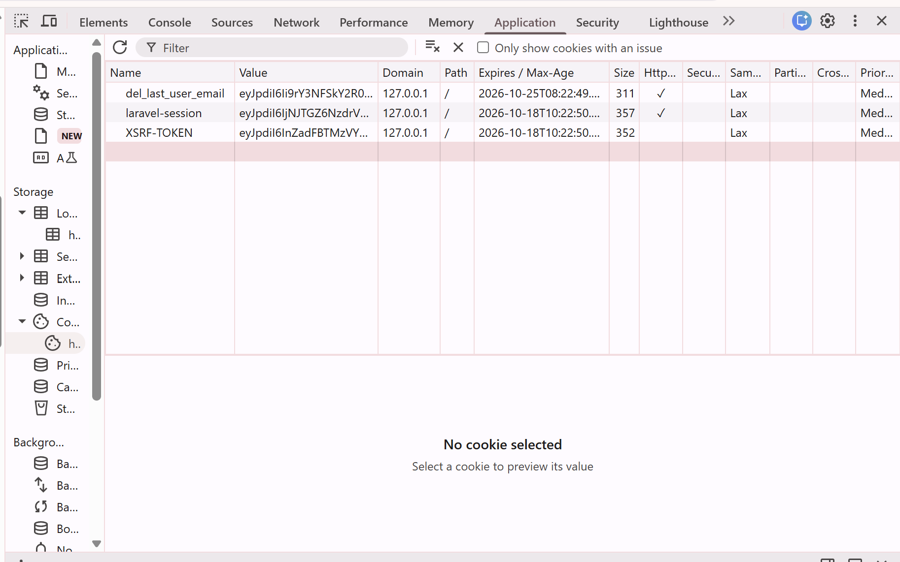
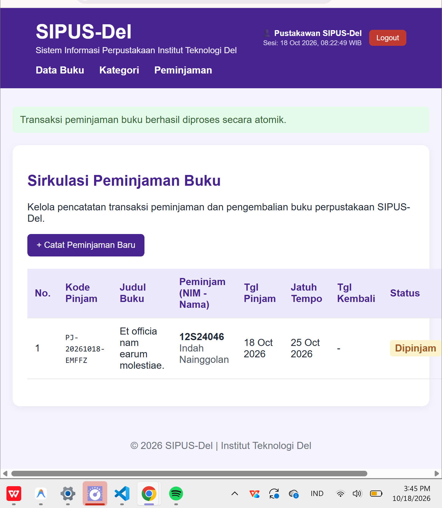
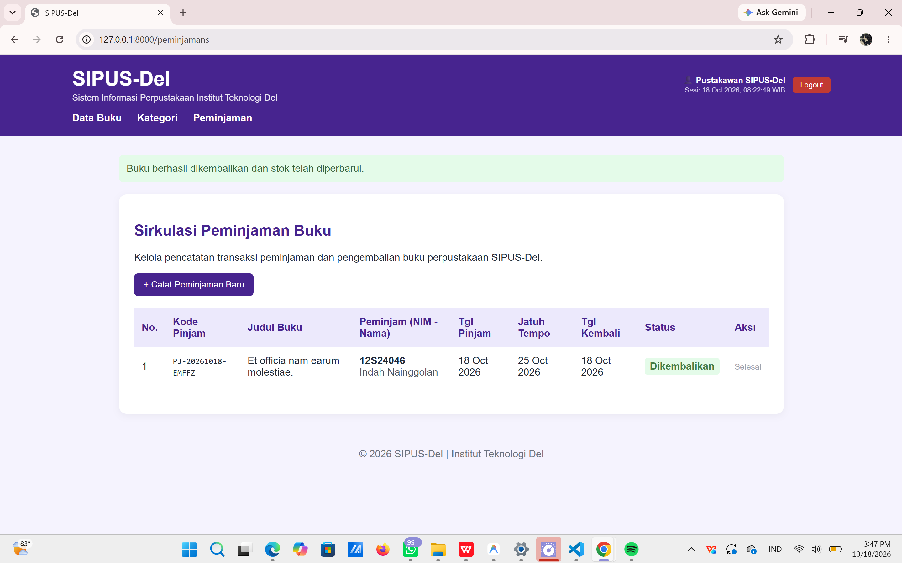
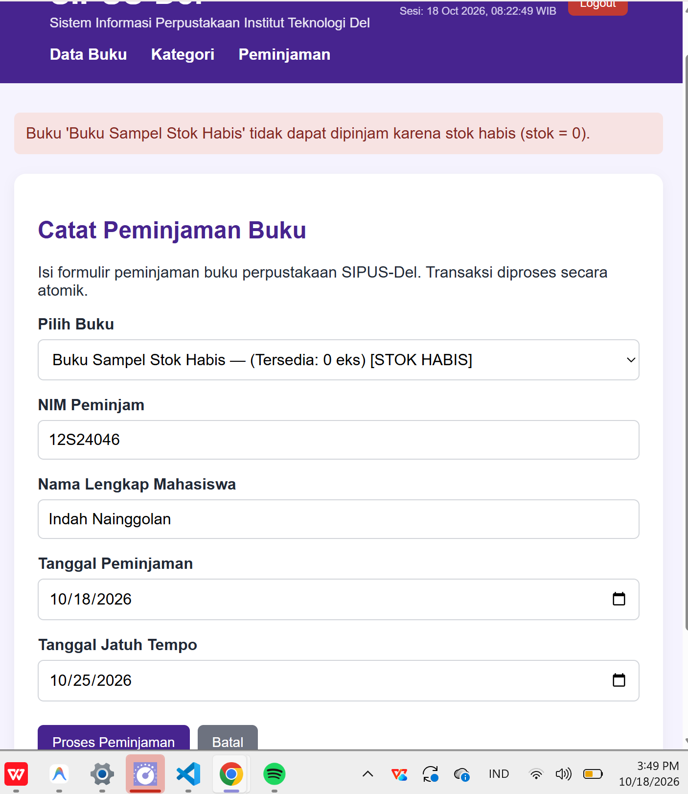

# SIPUS-Del — Sistem Informasi Perpustakaan

SIPUS-Del adalah aplikasi web sederhana untuk mengelola data buku dan kategori buku pada perpustakaan. Aplikasi ini dibuat menggunakan Laravel sebagai bagian dari praktikum Pemrograman dan Pengembangan Web.

## Fitur

- Menampilkan daftar buku.
- Menambahkan data buku baru.
- Melihat detail buku.
- Mengedit data buku.
- Menghapus data buku.
- Mengelola kategori buku melalui fitur CRUD.
- Menghubungkan buku dengan kategori menggunakan Eloquent Relationship.
- Melakukan validasi input.
- Menampilkan data buku beserta kategorinya menggunakan eager loading.
- Menampilkan daftar buku dengan pagination.
- Menampilkan pesan berhasil setelah operasi tertentu.
- Mencatat transaksi peminjaman dan pengembalian buku.
- Melindungi fitur peminjaman melalui login pustakawan.
- Menampilkan statistik dan pencarian buku.

## Teknologi yang Digunakan

- PHP 8.4
- Laravel 13
- SQLite
- Blade Template
- Eloquent ORM
- Query Builder
- HTML dan CSS

## Struktur Data

### Tabel `kategoris`

- `id`
- `kode_kategori`
- `nama_kategori`
- `created_at`
- `updated_at`

### Tabel `bukus`

- `id`
- `isbn`
- `judul`
- `penulis`
- `penerbit`
- `tahun_terbit`
- `kategori_id`
- `stok`
- `sinopsis`
- `created_at`
- `updated_at`

### Tabel `peminjamans`

Tabel `peminjamans` digunakan untuk menyimpan transaksi peminjaman buku.

- `id`: ID transaksi.
- `kode_pinjam`: kode unik transaksi peminjaman.
- `buku_id`: ID buku yang dipinjam.
- `nim_peminjam`: NIM mahasiswa yang meminjam.
- `nama_peminjam`: nama mahasiswa yang meminjam.
- `tanggal_pinjam`: tanggal peminjaman.
- `tanggal_jatuh_tempo`: batas waktu pengembalian.
- `tanggal_kembali`: tanggal pengembalian aktual, dapat bernilai kosong selama buku belum dikembalikan.
- `status`: status transaksi, misalnya `dipinjam` atau `dikembalikan`.
- `created_at`
- `updated_at`

## Relasi Database

- Satu kategori dapat memiliki banyak buku (*One-to-Many*).
- Satu buku hanya terhubung dengan satu kategori (*Many-to-One*).
- Satu buku dapat memiliki banyak catatan transaksi peminjaman (*One-to-Many*).

Relasi dibuat menggunakan Eloquent Relationship pada model `Kategori`, `Buku`, dan `Peminjaman`.

## Eager Loading

Data buku beserta kategorinya diambil menggunakan:

```php
Buku::with('kategori')->latest()->paginate(10);
```

Eager loading digunakan untuk mengurangi query database berulang ketika menampilkan kategori dari banyak buku.

## Transaksi Peminjaman dan Pengembalian

Proses peminjaman dan pengembalian menggunakan transaksi database agar perubahan data buku dan transaksi peminjaman tetap konsisten.

Saat peminjaman dilakukan, sistem memeriksa ketersediaan stok buku. Jika stok habis, peminjaman ditolak. Jika peminjaman berhasil, stok buku diperbarui dan transaksi peminjaman dicatat.

Saat buku dikembalikan, status transaksi diperbarui dan stok buku ditambahkan kembali. Proses ini dirancang agar perubahan data tidak tersimpan sebagian ketika terjadi kegagalan.

## Login Pustakawan

Akun untuk pengujian login:

- **Email:** `pustakawan@del.ac.id`
- **Password:** `password123`

Akun dibuat menggunakan `PustakawanSeeder`. Password disimpan dalam bentuk hash, bukan sebagai teks biasa.

## Data Awal dan Data Sampel

Seeder kategori menyiapkan lima kategori. `BukuSeeder` membuat 20 data buku menggunakan factory.

`BukuSampelSeeder` menyiapkan dua buku untuk menguji kondisi stok.

| Judul | ISBN | Stok |
|---|---|---:|
| Buku Sampel Stok Habis | `9786020000001` | 0 |
| Buku Sampel Stok Satu | `9786020000002` | 1 |

Seeder buku sampel menggunakan `updateOrCreate()` berdasarkan ISBN agar data sampel yang sama tidak dibuat berulang kali.

## Instalasi dan Menjalankan Aplikasi

1. Clone atau salin proyek ke komputer.
2. Buka terminal pada folder proyek.
3. Instal dependency:

```bash
composer install
npm install
```

4. Siapkan file environment jika belum tersedia:

```bash
copy .env.example .env
php artisan key:generate
```

5. Pastikan konfigurasi database SQLite sudah benar dan file `database/database.sqlite` tersedia.
6. Jalankan migrasi:

```bash
php artisan migrate
```

7. Siapkan data awal sesuai kebutuhan. Untuk akun pustakawan dan dua buku sampel, jalankan:

```bash
php artisan db:seed --class=PustakawanSeeder
php artisan db:seed --class=BukuSampelSeeder
```

Untuk database baru yang memerlukan lima kategori dan 20 buku, jalankan `KategoriSeeder` terlebih dahulu, kemudian `BukuSeeder`. Hindari menjalankan `BukuSeeder` berulang kali karena seeder tersebut membuat 20 buku baru setiap kali dijalankan.

8. Jalankan aplikasi:

```bash
php artisan serve
```

9. Buka `http://127.0.0.1:8000` pada browser.

**Catatan:** Jangan menjalankan migrasi atau seeder secara sembarangan pada database yang sudah berisi data penting. Jangan menggunakan `migrate:fresh` pada database yang ingin dipertahankan karena perintah tersebut menghapus tabel beserta datanya.

## Pengujian

Pengujian dilakukan dengan memeriksa:

- Fitur CRUD buku dan kategori.
- Validasi input.
- Relasi antarmodel dan eager loading.
- Pagination dan pencarian buku.
- Statistik data perpustakaan.
- Login pustakawan dan perlindungan route.
- Peminjaman buku berhasil.
- Pengembalian buku berhasil.
- Penolakan peminjaman saat stok buku habis.
- Atribut `HttpOnly` pada cookie sesi.

## Bukti Pengujian Cookie HttpOnly

Pemeriksaan dilakukan melalui Chrome Developer Tools pada tab Application → Cookies. Cookie `laravel-session` memiliki atribut `HttpOnly` yang ditandai dengan tanda centang.



## Bukti Pengujian Transaksi

**1. Peminjaman buku berhasil**



**2. Pengembalian buku berhasil**



**3. Peminjaman ditolak saat stok habis (stok = 0)**



## Menjalankan Seeder

Seeder akun pustakawan dan buku sampel dapat dijalankan secara terpisah:

```bash
php artisan db:seed --class=PustakawanSeeder
php artisan db:seed --class=BukuSampelSeeder
```

`PustakawanSeeder` dan `BukuSampelSeeder` menggunakan `updateOrCreate()` sehingga data dengan identitas yang sama diperbarui, bukan dibuat berulang kali. `BukuSeeder` berbeda karena membuat 20 buku baru setiap kali dijalankan.

## Praktikum Minggu 9 — Web Services & REST API

**Branch tugas:** `week9-rest-api`

### Identitas Mahasiswa

- **Nama Lengkap:Indah Elsadai Nainggolan**
- **NIM:12S24046**
- **Kelas:SI 2**
- **Program Studi:Sistem Informasi**

### Analisis Kebutuhan dan Kelayakan Web Services

> Proyek Week 6 yang diberikan menggunakan Laravel 13; modul praktikum menyebut Laravel 11.x. Implementasi ini mengikuti versi proyek agar antarmuka Blade dan dependensi yang sudah ada tidak perlu diturunkan versinya.

| Sistem | Peran SIPUS-Del | Data/operasi |
|---|---|---|
| Aplikasi Yudisium lama | Provider SOAP | Memeriksa jumlah pinjaman aktif mahasiswa melalui XML `CheckClearanceStatus`. |
| Aplikasi Mobile dan kiosk mandiri | Provider REST | Membaca katalog, mengelola buku, dan memproses peminjaman/pengembalian melalui JSON. |
| OpenLibrary | Consumer REST | SIPUS-Del meminta metadata tambahan berdasarkan ISBN melalui Laravel HTTP Client. |

REST dipilih untuk aplikasi mobile dan kiosk karena resource buku dan peminjaman dapat dialamatkan melalui URI, memakai semantik HTTP yang umum, mengirim JSON ringan, serta menggunakan Bearer Token tanpa sesi browser. SOAP tetap disediakan untuk integrasi yudisium karena sistem tersebut membutuhkan kontrak XML/WSDL yang eksplisit dan kompatibilitas dengan aplikasi legacy. Endpoint SOAP tidak menggantikan API REST untuk klien baru.

### Katalog Endpoint

| Method | URI | Proteksi | Fungsi | Respons utama |
|---|---|---|---|---|
| GET | `/soap/sipus.wsdl` | Publik | Kontrak operasi SOAP bebas pustaka | 200 |
| POST | `/soap/sipus` | Publik | Memeriksa pinjaman aktif berdasarkan NIM | 200, 400 `soap:Fault` |
| GET | `/api/v1/bukus` | Publik | Katalog, pencarian, filter, pengurutan, dan paginasi | 200 |
| GET | `/api/v1/bukus/{id}` | Publik | Detail buku, kategori, dan riwayat pinjaman | 200, 404 |
| GET | `/api/v1/bukus/{id}/referensi-eksternal` | Publik | Metadata OpenLibrary berdasarkan ISBN | 200 |
| POST | `/api/v1/auth/login` | Publik | Membuat Sanctum Bearer Token | 200, 401 |
| GET | `/api/v1/auth/me` | Bearer Token | Profil pemilik token | 200, 401 |
| POST | `/api/v1/auth/logout` | Bearer Token | Mencabut token aktif | 200, 401 |
| POST | `/api/v1/bukus` | Bearer Token | Membuat buku | 201 + `Location`, 401, 422 |
| PUT | `/api/v1/bukus/{id}` | Bearer Token | Mengganti seluruh atribut buku | 200, 401, 404, 422 |
| PATCH | `/api/v1/bukus/{id}` | Bearer Token | Memperbarui sebagian atribut buku | 200, 401, 404, 422 |
| DELETE | `/api/v1/bukus/{id}` | Bearer Token | Menghapus buku tanpa pinjaman aktif | 204, 401, 404, 409 |
| GET | `/api/v1/peminjamans` | Bearer Token | Riwayat peminjaman terpaginasi | 200, 401, 422 |
| GET | `/api/v1/peminjamans/{id}` | Bearer Token | Detail transaksi peminjaman | 200, 401, 404 |
| POST | `/api/v1/peminjamans` | Bearer Token | Meminjam buku dan mengurangi stok secara atomik | 201 + `Location`, 401, 409, 422 |
| PATCH | `/api/v1/peminjamans/{id}/kembalikan` | Bearer Token | Mengembalikan buku dan menambah stok secara atomik | 200, 401, 404, 409 |

Kesalahan validasi, autentikasi, dan data/rute yang tidak ditemukan pada `/api/*` memakai `application/problem+json` dengan struktur RFC 7807. Tautan `_links.pinjam_buku` hanya muncul saat stok tersedia, sedangkan `_links.kembalikan_buku` hanya muncul saat transaksi masih berstatus `dipinjam`.

### Instalasi dan Pengujian Cepat

Untuk checkout dan database yang benar-benar baru, jalankan:

```bash
composer install
copy .env.example .env
php artisan key:generate
php artisan migrate --seed
```

Untuk proyek Week 6 yang databasenya sudah berisi data, cukup jalankan `composer install` dan `php artisan migrate`. Pertahankan `.env` yang sekarang dan jangan jalankan `migrate:fresh` atau seeder buku lagi; `BukuSeeder` menambahkan 20 buku baru setiap kali dijalankan.

Rute API Laravel 13 dimuat dari `routes/api.php`; Laravel Sanctum sudah tercatat sebagai dependensi Composer dan migrasi token dibuat oleh paket. Kredensial pustakawan lokal untuk pengujian: `pustakawan@del.ac.id` / `password123`. Base URL Postman adalah `http://127.0.0.1:8000`; impor `docs/SIPUS-Del-API-v1.postman_collection.json`, lalu isi `kategori_id` sesuai database. Jalankan request pencarian buku sampel stok habis agar `buku_stok_habis_id` terisi otomatis. ISBN untuk request pembuatan buku dibuat baru pada setiap run. Token login disimpan otomatis pada variabel koleksi `token` dan tidak boleh dimasukkan ke README atau Git.

Kontrak layanan tersedia di `docs/openapi-sipus-v1.yaml`. Setelah menjalankan aplikasi, lampirkan bukti uji asli pada bagian ini. Simpan screenshot di `dokumentasi/week9/` untuk: (1) SOAP sukses dan `soap:Fault`, (2) login dan Bearer Token yang sudah disensor, (3) katalog berpaginasi dengan `_links`, (4) POST buku 201 dan header `Location`, (5) perbedaan PUT dan PATCH, (6) peminjaman sukses dan penolakan 422/409, dan (7) latihan GitHub REST API dengan token disensor.

## Pengembang

Proyek praktikum Pemrograman dan Pengembangan Web — Institut Teknologi Del.
